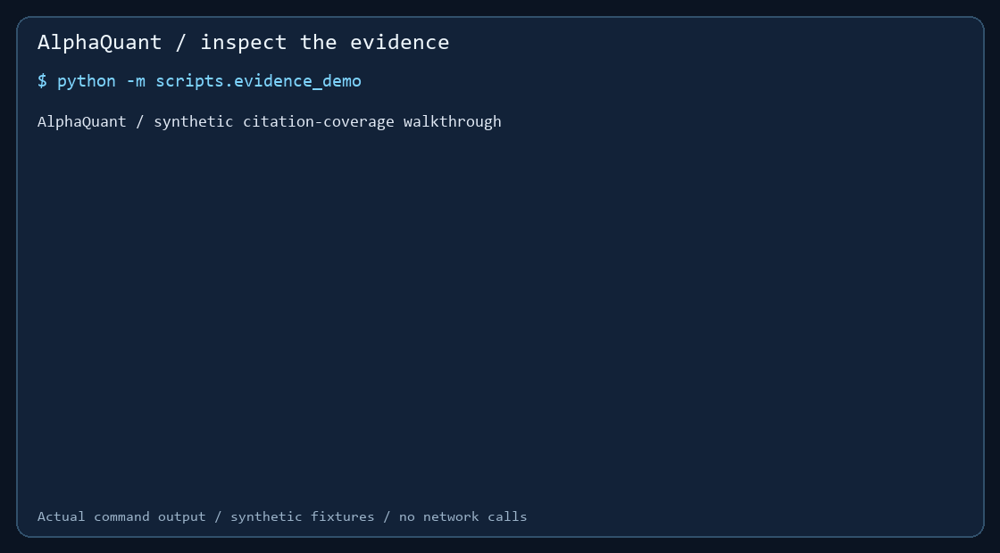

# AlphaQuant — inspect a research report's evidence

[](https://github.com/smgpulse007/AlphaQuant/actions/workflows/evidence.yml)

**Check citation coverage before a research report moves downstream.** Catch reports that cite the same host twice, omit citations from a claim-bearing section, or quietly pass an empty result. Run the dependency-free checker offline, inspect the findings, and use its exit status in your own evaluation loop.



The recording comes from the real command below, using fictional `.example` URLs. [Output and source hashes](artifacts/evidence-demo.json).

## Try it in a minute

Python 3.11 or newer is enough for the checker and fixture pipeline. No package install, Docker service, API key, model download, or network access is required.

```sh
git clone https://github.com/smgpulse007/AlphaQuant.git
cd AlphaQuant
python -m scripts.evidence_demo
python -m unittest discover -s tests -v
```

The walkthrough deliberately shows both passing and failing cases. A pass means two distinct, syntactically valid HTTP(S) citation hostnames for each checked item. It does **not** mean that the sources were retrieved, are independent publishers, support the claim, or make it true.

## Check your own structured report

Save this as `report.json`:

```json
{
  "market_scan": {
    "macro": {
      "facts": ["A synthetic claim for demonstrating the format."],
      "citations": [
        {"url": "https://one.example/source"},
        {"url": "https://two.example/source"}
      ]
    }
  },
  "trades": []
}
```

```sh
python -m scripts.verify_report report.json
```

Exit codes: **0** meets coverage policy, **1** fails coverage, **2** is unreadable, oversized, or invalid input. The command reads at most 1 MiB and prints an audit; it never fetches citation URLs or writes the input file. Import `audit_report` from `src.orchestrator.verifier` to embed the same check in Python.

Claim sections use `facts`, `highlights`, or `contradictions` arrays of nonempty strings, plus a `citations` array. Unsupported claim fields are rejected instead of silently ignored. Every trade object is checked. Nonempty event lists without structured citations fail coverage. Case, a leading `www.`, trailing DNS dots, paths, fragments and ports do not create extra hosts. This is hostname counting, not publisher attribution or fact checking.

The legacy `audit.double_source` field represents this coverage policy. `source_content_verified` is always false because this checker does not retrieve or inspect sources. Per-item counts and warnings explain the outcome.

Coverage checking validates the citation-bearing report shape, not the full [API response schema](src/orchestrator/schemas.py). A trade still needs its required API fields when used with `RunOutput`. Duplicate JSON keys, non-finite constants, and excessive nesting are rejected by the CLI.

## Explore the existing pipeline

```sh
python -m scripts.run_small_world --summary
python -m scripts.run_small_world
```

Run these module commands from the repository root. The sequential Python pipeline passes state through discovery, crawling, normalization, analysis, synthesis, and verification stages. **Its data adapters, analysis and trade proposals are placeholders.** It does not call an LLM, retrieve live market data, or place trades. Fixed scores, confidence values, option parameters and dated sample outputs are illustrative, not calibrated predictions or actionable recommendations.

Outputs identify `synthetic: true`, `execution: fixture_pipeline`, and UTC-generated timestamps. The current politician highlight has no citations, so the fixture pipeline correctly reports failed coverage. The warning identifies exactly which section needs evidence.

The broader [FastAPI routes](src/api), [Compose stack](docker-compose.yml), [storage adapters](src/storage), and [frontend contract](bolt/api_contract.json) are retained for further development. Several endpoints and storage methods return fixtures or remain TODOs. Their older dependency sets and complete multi-service runtime are outside the tested offline path.

The public tree contains no `frontend` source directory; `docker-compose.ui.yml` therefore cannot build its referenced UI from this checkout alone. Historical [UI image](artifacts/ui-screenshot.png), [UI recording](artifacts/ui-demo.gif), and [setup tapes](artifacts/quick-setup.tape) are retained as context, not a reproducible public UI quickstart.

## Develop and verify

CI runs the standard-library tests and both module walkthroughs on Windows/Linux with Python 3.11/3.13. Tests cover repeated hosts, malformed URLs and report shapes, missing sections, empty reports, repeat verification, CLI exit codes, UTC output, and a network-blocked fixture pipeline. They do not establish model quality, source correctness, investment performance, or the full Compose deployment.

To regenerate the terminal GIF, install Pillow in your development environment and run `python scripts/record_evidence_demo.py`. It executes the real walkthrough and records its output and canonical source hashes.

Useful next work: source-retrieval receipts with content hashes, claim-to-passage links, evaluated extraction, and a public frontend backed by real contracts. Keep fixtures synthetic and make evaluation limits explicit.

See [Contributing](CONTRIBUTING.md) and the existing [MIT license](LICENSE). Research and engineering demo only; not an investment product or live-trading system.
